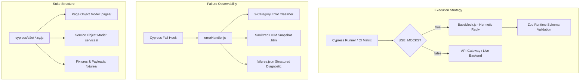

# 🧪 Enterprise Cypress Automation Suite — Omnichannel Platform & CRM

[](https://github.com/Kal9941/cypress-enterprise-suite/actions/workflows/cypress.yml)
[](https://www.cypress.io/)
[](https://k6.io/)
[](#-architecture-and-engineering-patterns)
[](#-ai-agent-governance-and-tooling)

> 🌐 **Language Note:** While this documentation is written in English for international review, the entire codebase, test specifications, Gherkin step descriptions, and `.agents/` context files are authored in **Brazilian Portuguese (pt-BR)**, as originally engineered for enterprise regional operations.

---

## 📌 Project Overview

This repository contains an enterprise-grade test automation and performance framework for a large-scale Omnichannel & CRM platform (React SPA + REST API). It integrates **Cypress v15** (End-to-End UI, API contract, and integration tests) with **k6** (load and performance testing), orchestrating a matrix CI/CD pipeline on **GitHub Actions** with consolidated interactive HTML (Mochawesome) and JUnit XML reporting.

The suite features over **1,190 automated tests** structured across 16 modular E2E/backend specification suites (`cypress/e2e/`), backed by automated route auditing scripts and performance test plans.

### Key Technical Highlights:
* **Hybrid Mock Architecture (Strategy Pattern):** Powered by `BaseMock.js`, allowing tests to run either 100% hermetically offline (`USE_MOCKS: true`) in sub-seconds or against live staging environments without changing test code.
* **Runtime Contract Validation:** Payloads intercepted during mock execution are validated in real-time using **Zod** (`cypress/support/schemas.js`) to prevent contract drift between frontend and backend.
* **Intelligent Failure Classifier (`errorHandler.js`):** Automatically intercepts test failures, classifies the root cause across 9 discrete diagnostic categories, sanitizes sensitive JWT tokens, and captures navigable DOM snapshots (`last-failure-dom.html`).
* **AI-Augmented QA Engineering (`.agents/`):** Houses a persistent Hot/Cold external memory system for autonomous AI coding agents (Antigravity, Claude Code, Cursor) to self-diagnose and maintain test suites without manual overhead.

---

## 🏗️ Architecture and Engineering Patterns



### Core Design Principles:
1. **Strategy Pattern for Network Mocking (`BaseMock.js`):**
   Subclasses in `cypress/mocks/` encapsulate route intercept definitions. When `USE_MOCKS: true`, responses are served deterministically from local fixtures (`req.reply`). In live mode, requests pass through (`req.continue`).
2. **Deterministic Test Isolation (Arrange-Act-Assert):**
   Every test enforces strict boundary separation:
   * **Arrange:** Set up preconditions, authentication (`cy.login()`), and route mocks.
   * **Act:** Trigger the specific user or API action being validated.
   * **Assert:** Verify DOM mutation or API contract (`expect`/`should`).
3. **Session Namespace Isolation (`SESSION_LABEL`):**
   To support multi-instance parallel runs on a single machine without artifact collision, report and failure directories are dynamically namespaced by session labels or process PIDs.
4. **WABA / Messaging Resilience:**
   Specialized handlers for 24-hour customer service WhatsApp session windows, media upload bounds (MP3, MP4, PDF size limits), and dynamic polling mechanisms.

---

## 🧪 Test Suite Distribution

| Spec File | Scope / Domain Covered | Test Count |
| :--- | :--- | :---: |
| `0-A.backend-acesso-cadastros-orcamentos.cy.js` | Direct API Contracts: Auth, RBAC capabilities, store settings, catalogs, clients, budgets & payment links | 216 |
| `0-B.backend-atendimentos.cy.js` | Direct API Contracts: Queue lifecycle, agent routing, messages, attachments, reactions, SSE events | 106 |
| `0-C.backend-receitas.cy.js` | Direct API Contracts: Medical prescriptions, formulas, controlled substances, batch linkage | 181 |
| `0-D.backend-automacoes-fluxos-campanhas.cy.js` | Automation Engine: Event triggers, step sequencing, webhooks, scheduled delays | 29 |
| `1.permissoes.cy.js` | Dual-level Permissions Matrix (Payload verification + UI controls) | 45 |
| `2.login.cy.js` | Auth security: Input masks, rate limits, invalid credentials, token session refresh | 25 |
| `3.central.cy.js` | Executive Analytics: Dashboards, period filters, KPIs, dark/light theme switching | 17 |
| `4.iniciar-atendimento.cy.js` | WABA messaging initiation: Templates with dynamic variables, client search | 19 |
| `5-A.atendimentos-fila.cy.js` | Omnichannel Queue: Advanced filtering, priority ordering, status escalation, transfer modals | 95 |
| `5-B1.atendimentos-chat-componentes.cy.js` | Chat Components: Attachments (PDF/Images/Audio), boundaries, clipboard image pasting | 59 |
| `5-B2.atendimentos-chat-janela.cy.js` | 24-hour messaging window compliance, WABA template precedence, custom budget drawers | 59 |
| `5-B3.atendimentos-chat-mensagens.cy.js` | Message Lifecycle: Resend on network timeout, binary media fetch, message reactions, AI budget updates | 52 |
| `5-C.atendimentos-clientes.cy.js` | Customer Drawers: Multi-step forms, document masking (CPF/CNPJ locks), CEP postal code lookup | 96 |
| `6.receitas.cy.js` | Prescriptions UI: Formula keyboard navigation, dosage boundary validation, search without accents | 68 |
| `7.clientes.cy.js` | Customer Management: Infinite scrolling, search normalization, tabbed customer records | 63 |
| `8.automacoes.cy.js` | Visual Workflow Builder: Node reordering, conditional branching (3 levels), webhook steps | 60 |
| **Total** | **Comprehensive Enterprise Coverage** | **1,190** |

---

## 🚀 Getting Started & Execution

### Prerequisites
* **Node.js:** v20.x or v24.x (LTS recommended)
* **npm:** v10+

### Installation
```bash
git clone https://github.com/Kal9941/cypress-enterprise-suite.git
cd cypress-enterprise-suite
npm ci
```
> `npm ci` automatically triggers `patch-package` to apply necessary fixes for reporter plugins.

### Configuration (`env.json`)
The test environment is configured via `env.json`:
```json
{
  "BASE_URL": "http://localhost:3000",
  "API_URL": "http://localhost:3333/api",
  "USE_MOCKS": true,
  "AUTO_SYNC_MOCKS": false,
  "USER_CNPJ": "00000000000191",
  "USER_CODE": "001",
  "USER_PASSWORD": "DemoPassword123!",
  "DEFAULT_CELULAR": "11999998888",
  "DEFAULT_CLIENT_NAME": "Cliente Demonstração"
}
```

### Running Tests

#### 1. 100% Hermetic Mock Mode (Default - Fast & Offline):
```bash
npm test
# or run with interactive UI
npm run cypress:open
```

#### 2. Running a Single Spec:
```bash
npx cypress run --browser chrome --spec cypress/e2e/2.login.cy.js
```

#### 3. Running Performance / Load Tests with k6:
```bash
# Run login endpoint load test
npm run k6:login

# Run attendance queue performance test
npm run k6:atendimentos
```

#### 4. Automated Route Contract Audit:
```bash
npm run audit:routes
```

---

## 🤖 AI Agent Governance (`.agents/`)

This project implements a state-of-the-art persistent memory architecture for AI coding assistants:
* **`AGENTS.md`**: Operational guidelines, diagnostic budgets, and rules with permanent anchors (`[R-*]`).
* **`PROJECT_CONTEXT.md`**: Canonical inventory mapping every test scenario to its exact line (`L:`).
* **`ROADMAP.md`**: Backlog priorities (P0, P1, P2) and active session checkpoints.
* **`HISTORICO.md`**: Immutable log of deliveries, regressions, and validation history.

Lint the agent documentation rules anytime:
```bash
npm run docs:lint
```

---

## 👤 Author
**Klismam Monteiro**
* GitHub: [@Kal9941](https://github.com/Kal9941)
* Email: [klismammonteiro1994@outlook.com](mailto:klismammonteiro1994@outlook.com)
